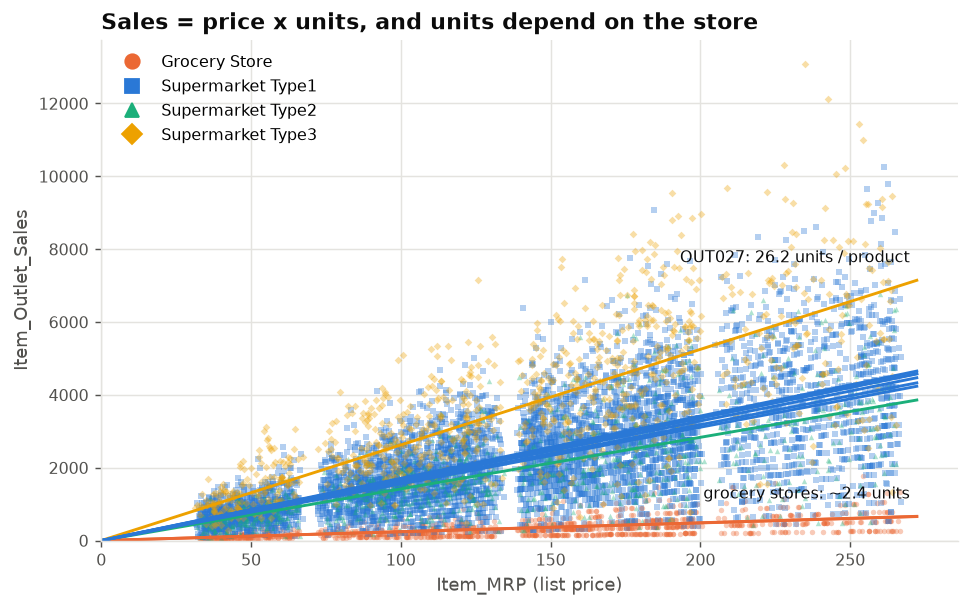
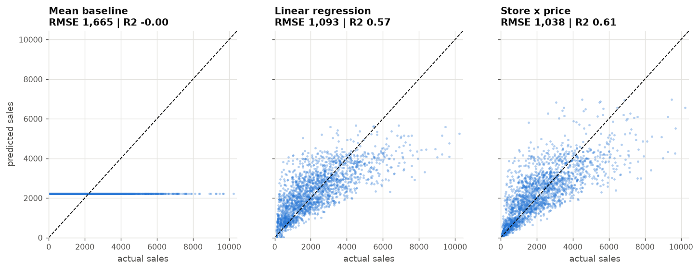
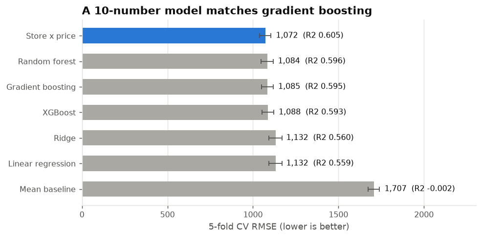
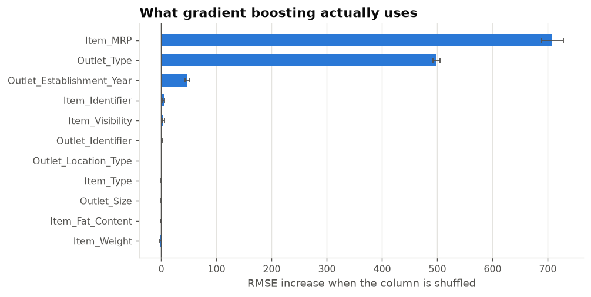
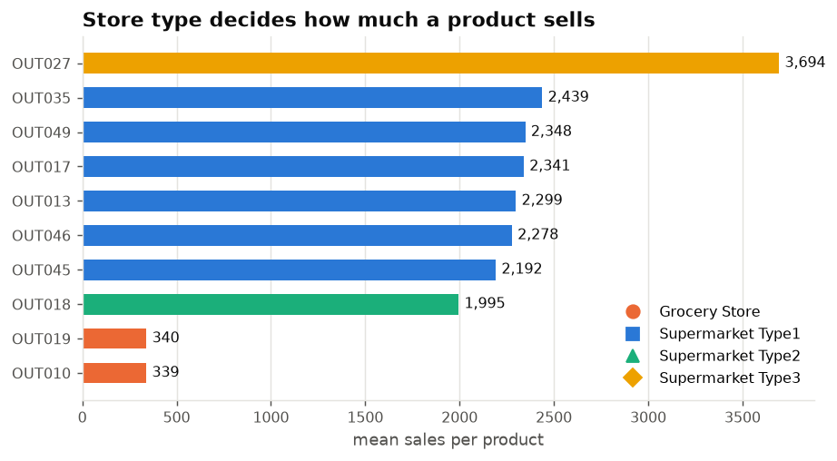
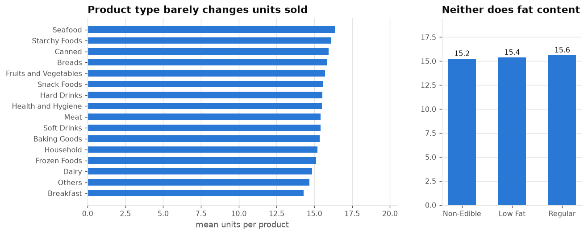
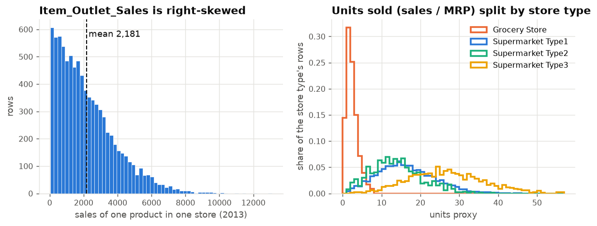
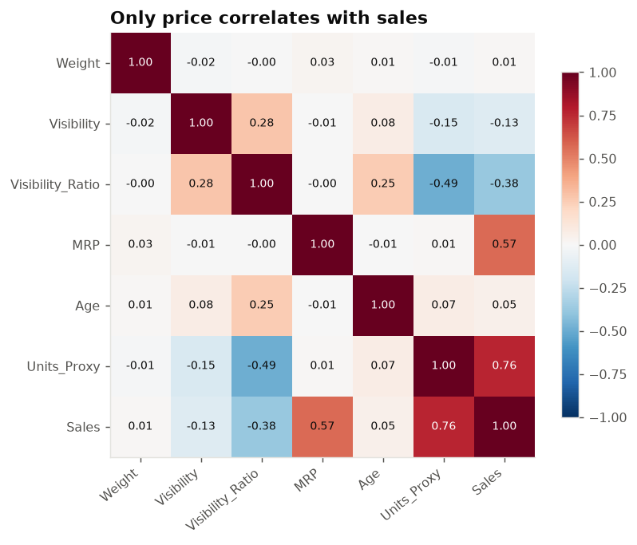
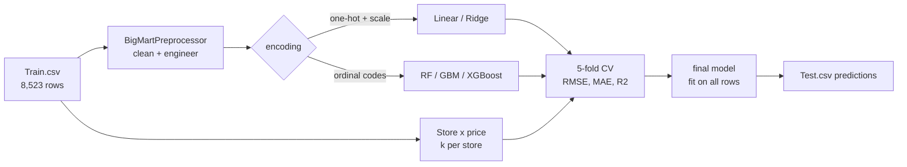

# BigMart Sales: Data Analysis and Prediction

[](pyproject.toml)
[](src/bigmart/models.py)
[](tests)
[](LICENSE)
[](https://colab.research.google.com/github/benisalla/BigMart-Data-Analysis-and-Prediction/blob/main/notebooks/bigmart_sales_analysis.ipynb)

BigMart recorded the 2013 sales of **1,559 products in 10 stores**. This project predicts
`Item_Outlet_Sales` for every product/store pair and answers the business question
behind it: **what actually drives sales?** It covers data cleaning, hypothesis-driven
EDA, and seven models compared with leakage-free 5-fold cross-validation.

**Main result:** sales are *list price x units sold*, and the units are set almost
entirely by the store. A 10-parameter model, `sales = k[store] x price`, predicts as
well as random forest, gradient boosting and XGBoost (CV RMSE **1,072** vs 1,084-1,088,
R2 **0.605**), and every coefficient reads as a business number.

<p align="center">
  
</p>

## Key findings

| | Finding | Evidence |
|---|---|---|
| 1 | **Price drives revenue, not volume.** Expensive products bring more sales because units do not fall with price. | corr(price, sales) = 0.57; corr(price, units) = 0.01 |
| 2 | **The store decides the units.** A product sells ~2.4 units in a grocery store, ~16 in a Type 1 supermarket, ~26 in the Type 3 supermarket. | store type explains 24% of the variance; OUT027 alone brings 18.6% of revenue |
| 3 | **Product attributes barely matter.** Fat content, category, weight and shelf visibility do not change units sold. | units per product 14.3-16.4 across 16 categories; low fat vs regular p = 0.29 |
| 4 | **Size, city tier and store age are weak drivers** once the store format is known. | eta2 = 0.048 (size), 0.013 (tier); corr(age, sales) = 0.05 |
| 5 | **The data, not the model, caps accuracy at R2 ~0.60.** Flexible models only rediscover price x store. | permutation importance: price 708, store type 498, every product column < 5 |

**For the business:** growth comes from the store side, such as moving stores toward the
Type 3 format, which sells 1.6x more units per product than Type 1. Product attributes
like fat content or display share make no measurable difference. The full table of
hypotheses is in [docs/results.md](docs/results.md#hypotheses-reportshypothesesmd).

## Before vs after

Predicted against actual sales on the same held-out 25%: no model (predict the mean),
a linear regression like the one in the original notebook, and the final Store x price model.

<p align="center">
  
</p>

## Results

5-fold cross-validation on `Train.csv` (8,523 rows). Every model is a full pipeline
refitted inside each fold.

| Model | CV RMSE | MAE | R2 |
|---|---:|---:|---:|
| **Store x price** (10 parameters) | **1,071.6 +- 33.4** | **750.3** | **0.605** |
| Random forest | 1,083.7 +- 35.7 | 757.1 | 0.596 |
| Gradient boosting | 1,084.9 +- 33.5 | 758.8 | 0.595 |
| XGBoost | 1,087.8 +- 34.2 | 760.7 | 0.593 |
| Ridge | 1,131.8 +- 37.6 | 839.5 | 0.560 |
| Linear regression | 1,131.8 +- 37.7 | 839.5 | 0.559 |
| Mean baseline | 1,706.7 +- 32.2 | 1,346.9 | -0.002 |

<p align="center">
  
  
</p>

The experiments that did not help (target encoding of products, log target, blending)
are in [docs/methodology.md](docs/methodology.md#experiments-that-did-not-help).

## Exploratory analysis

<table>
  <tr>
    <td></td>
    <td></td>
  </tr>
  <tr>
    <td></td>
    <td></td>
  </tr>
</table>

### Data cleaning

| Problem in the raw data | Fix |
|---|---|
| `Item_Weight` missing in 17% of rows | filled from the same product in other stores |
| `Outlet_Size` missing for 3 whole stores | most common size of the same store type |
| `Item_Visibility` = 0 in 526 rows | the product's mean visibility |
| `Item_Fat_Content` spelled 5 ways, set for household products | Low Fat / Regular / Non-Edible |

All of it lives in one scikit-learn transformer (`BigMartPreprocessor`) that learns only
from training rows. Column definitions are in the [data dictionary](docs/data_dictionary.md).

## Pipeline



## Quickstart

```bash
git clone https://github.com/benisalla/BigMart-Data-Analysis-and-Prediction.git
cd BigMart-Data-Analysis-and-Prediction
pip install -e ".[dev]"

bigmart-train --model store_price           # CV score, then fit and save models/bigmart_model.pkl
bigmart-predict --out submission.csv        # predictions for data/raw/Test.csv
python scripts/make_report.py               # every table and figure in reports/ (~2 min)
pytest                                      # 22 tests
```

From Python:

```python
from bigmart.data import load_train, load_test, split_xy
from bigmart.models import build_model

X, y = split_xy(load_train())
model = build_model("store_price").fit(X, y)      # or "xgboost", "gradient_boosting", ...
print(model.multipliers_)                         # units sold per product, by store
predictions = model.predict(load_test())
```

## Examples

Numbered scripts in [`examples/`](examples) that use the package step by step, each
running on a CPU in seconds:

| Script | What it shows |
|---|---|
| [`01_load_and_clean.py`](examples/01_load_and_clean.py) | the raw data problems and the cleaned frame |
| [`02_explore_the_drivers.py`](examples/02_explore_the_drivers.py) | store table and hypothesis checks |
| [`03_compare_models.py`](examples/03_compare_models.py) | 5-fold CV of all seven models |
| [`04_store_price_model.py`](examples/04_store_price_model.py) | the 10-number model, read as units per store |
| [`05_feature_importance.py`](examples/05_feature_importance.py) | permutation importance of gradient boosting |
| [`06_train_and_predict.py`](examples/06_train_and_predict.py) | train, then write a submission for Test.csv |
| [`07_make_figures.py`](examples/07_make_figures.py) | regenerate the main EDA figures |

## Notebooks

- [`notebooks/bigmart_sales_analysis.ipynb`](notebooks/bigmart_sales_analysis.ipynb): the
  full analysis, executed, with every figure. It calls the package, runs on Colab or
  Kaggle as-is, and is rebuilt with `python notebooks/build_notebook.py --execute`.
- [`notebooks/original_colab_notebook.ipynb`](notebooks/original_colab_notebook.ipynb): the
  first version of the project, kept for reference. The fixes made since are listed in
  [docs/methodology.md](docs/methodology.md#what-changed-from-the-original-notebook).

## Project layout

```
├── data/raw/                 Train.csv, Test.csv
├── src/bigmart/
│   ├── data.py               loading, column names
│   ├── preprocessing.py      BigMartPreprocessor: cleaning + feature engineering
│   ├── models.py             seven models, StorePriceRegressor, build_model()
│   ├── evaluate.py           cross-validation, hold-out, permutation importance
│   ├── insights.py           hypothesis tests, store summary
│   ├── plots.py              all figures
│   └── cli.py                bigmart-train, bigmart-predict
├── scripts/make_report.py    regenerates reports/
├── reports/                  metrics.json, model_comparison.csv, hypotheses.md, figures/, submission.csv
├── notebooks/                analysis notebook (+ builder), original notebook
├── examples/                 numbered usage scripts
├── docs/                     data dictionary, methodology, results
└── tests/                    pytest suite
```

## Data

From the Analytics Vidhya [BigMart Sales Prediction](https://www.analyticsvidhya.com/datahack/contest/practice-problem-big-mart-sales-iii/)
practice problem. The CSV files are included in `data/raw/` for reproducibility.

## License

[GPL-3.0](LICENSE).
